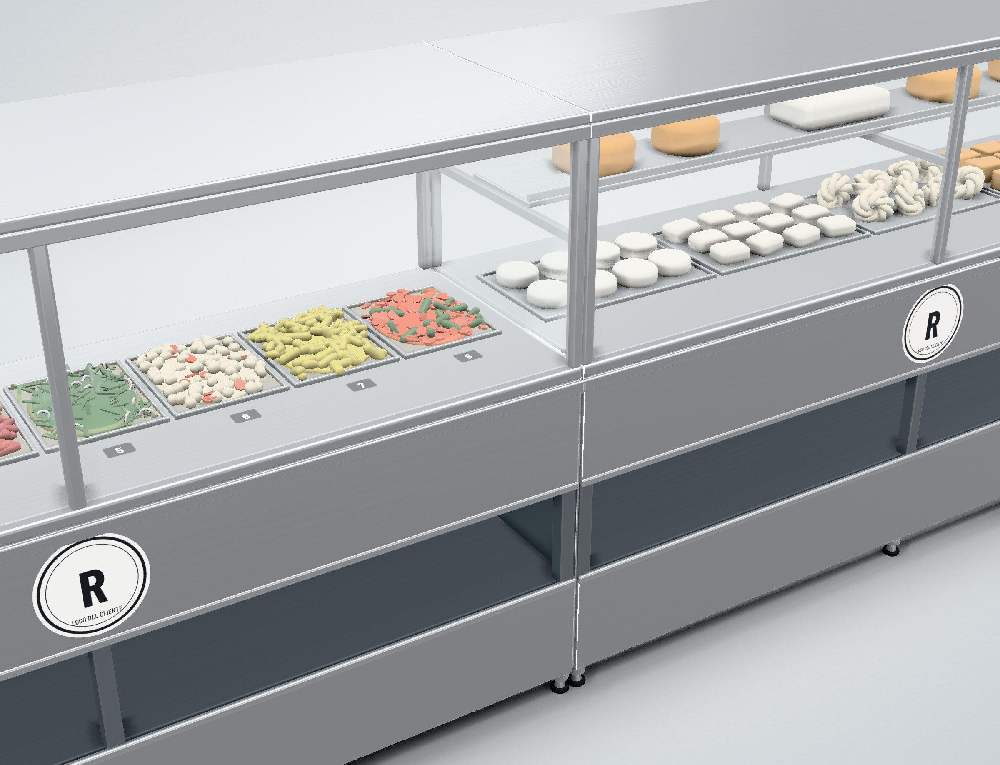
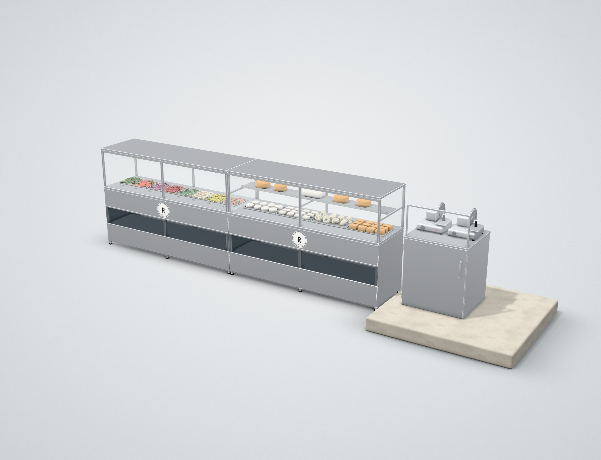
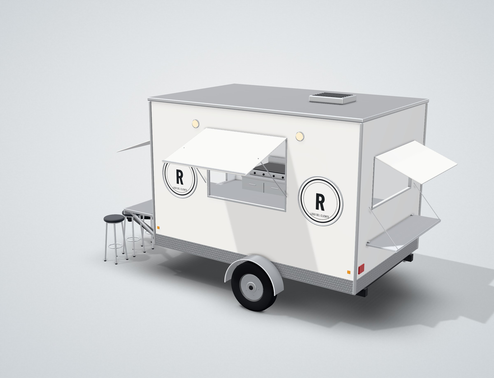

# Puesto y Remolque 3D

Propuesta de diseño en 3D de un **puesto de acero inoxidable** y un **remolque con barra**. Se abre en el navegador, en computadora o celular, sin instalar nada.

<p>
  <a href="https://eliasgaribi-ctrl-z.github.io/puesto-remolque-3d/"></a>
  &nbsp;
  <a href="https://eliasgaribi-ctrl-z.github.io/puesto-remolque-3d/#puesto"></a>
  &nbsp;
  <a href="https://eliasgaribi-ctrl-z.github.io/puesto-remolque-3d/#remolque"></a>
</p>



| Puesto completo | Remolque con barra |
| --- | --- |
|  |  |

## Qué se puede hacer en el visor

- **Girar, acercar y mover** el modelo con el mouse o con los dedos.
- **Vistas rápidas**: 3/4, frente, costado, planta y más.
- **Mover piezas**: abrir la puerta del mueble, subir y bajar las tapas de las ventanas, bajar la repisa trasera.
- **Cambiar acabados**: frente inox o blanco en el puesto; caja blanca, grafito o inox en el remolque.
- **Cotas** sobre el modelo y tabla de medidas en cm. Las medidas marcadas como *supuesto* se confirman antes de fabricar.
- **Foto HD**: descarga una imagen en alta resolución de la vista actual.
- **Modelo .glb**: descarga el modelo 3D para abrirlo en otros programas.

## Archivos

| Archivo | Para qué sirve |
| --- | --- |
| [`index.html`](index.html) | El visor completo en un solo archivo. Funciona sin internet si lo descargas. |
| [`modelos/`](modelos/) | Los modelos 3D en `.glb` (puesto y remolque), en metros. |
| [`renders/`](renders/) | Imágenes listas para presentar. |
| [`fuente/`](fuente/) | Código fuente del visor y de los modelos. |

## Editar los modelos

Los modelos se construyen con código en [`fuente/src/`](fuente/src/) (`puesto.js` y `remolque.js`), con las medidas en centímetros tal como vienen en el boceto. Para regenerar `index.html`:

```bash
cd fuente
npm install
npm run build
```

Los logos son provisionales.
